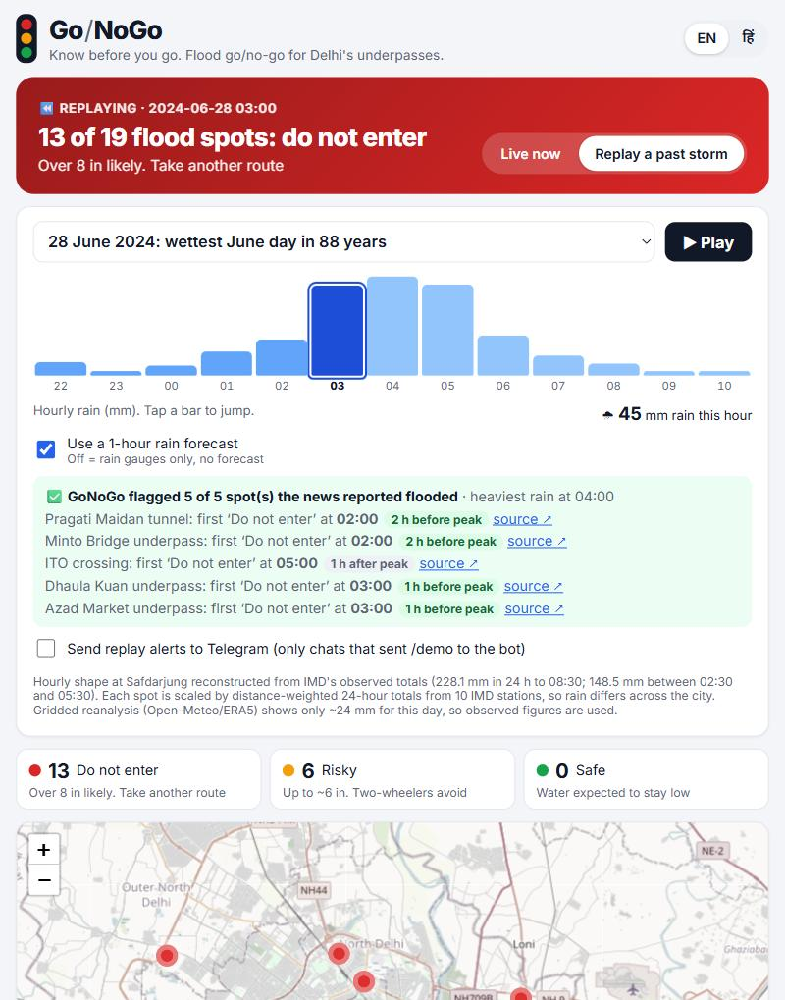
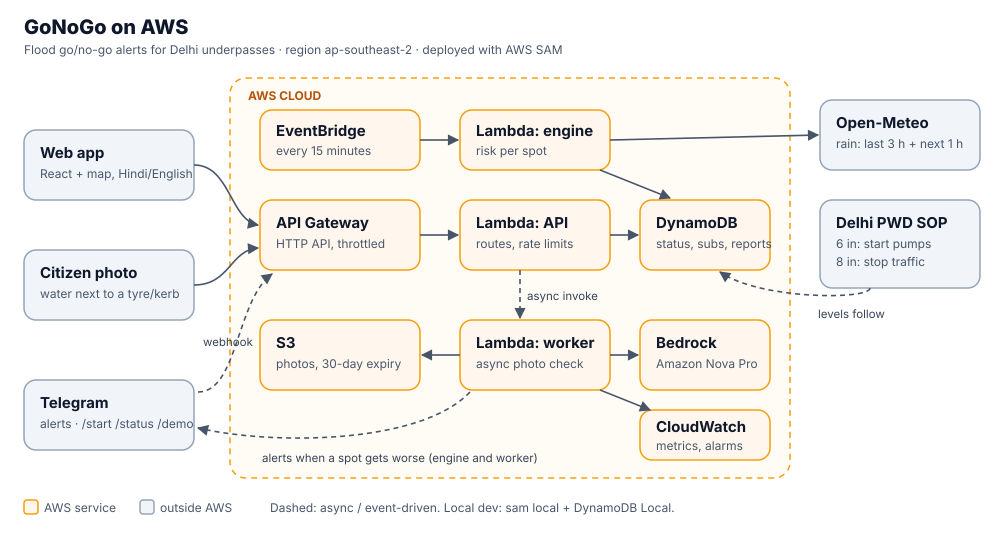

# GoNoGo: know before you go

[](https://github.com/Vardhan-Mittal/gonogo/actions/workflows/ci.yml)

**Flood go/no-go alerts for Delhi's underpasses, before you drive into one.**

Built for *Environmental Hacks* (Bharat Builds Tour, WeMakeDevs × AWS), Heat & Water track.

**Live demo (on AWS):** https://dq1ucov7xi7l8.cloudfront.net (S3 + CloudFront; mirror: https://gonogo-tau.vercel.app) · **Telegram bot:** [@Vami25bot](https://t.me/Vami25bot)



## The problem

Every monsoon, people in Delhi-NCR drown in places they drive through every day:

| Date | Where | What happened |
|---|---|---|
| 19 Jul 2020 | Minto Bridge underpass, Delhi | Tempo driver drowned driving through the flooded underpass ([Scroll](https://scroll.in/latest/967932/delhi-one-die-as-heavy-rain-hits-capital-traffic-jams-power-outages-in-several-places)) |
| 27 Jul 2024 | Old Rajinder Nagar, Delhi | Three UPSC aspirants drowned in a flooded coaching-centre basement ([Business Standard](https://business-standard.com/india-news/2-students-drown-in-flooded-delhi-coaching-centre-basement-after-heavy-rain-124072700966_1.html)) |
| 31 Jul 2024 | Ghazipur, Delhi | A mother and her 3-year-old son drowned in a waterlogged drain ([National Herald](https://www.nationalheraldindia.com/national/heavy-rain-brings-delhi-to-its-knees-2-drown-in-ghazipur-schools-closed)) |
| 13 Sep 2024 | Old Faridabad railway underpass | Two bank employees moved a barricade and drove in; both drowned ([Tribune](https://www.tribuneindia.com/news/haryana/faridabad-drowning-suv-driver-ignored-warning-barricades-claim-cops)) |

Delhi has **410 waterlogging points** (traffic police, 2025). Today's warnings are traffic-police posts made *after* a spot floods, or a barricade *at* the spot, which Faridabad showed is too late. People need the warning before they leave.

## What GoNoGo does

- **Safe / Risky / Do not enter** for 19 known Delhi flood spots, updated every 15 minutes from rainfall in the last hour, the last 3 hours and the next hour.
- Levels follow **Delhi PWD's own underpass procedure**: start pumps at 6–8 inches of water, stop traffic above 8 inches.
- **Telegram alerts in Hindi or English** for the spots on your daily route, sent when a spot gets worse.
- **Citizen photo reports:** Amazon Nova Pro on Amazon Bedrock estimates water depth against a car tyre, kerb or person, and the spot updates immediately.
- **Storm replay** of real Delhi storms (28 Jun 2024, 31 Jul 2024, 19 Jul 2020), checked against flooding the news reported.

## Built on AWS

| Service | Role |
|---|---|
| AWS Lambda | API, the risk engine, and an async photo-report worker (Python 3.12) |
| Amazon API Gateway (HTTP API) | Public API for the web app and the Telegram webhook |
| Amazon EventBridge Scheduler | Runs the risk engine every 15 minutes |
| Amazon DynamoDB | Live status, subscribers, photo reports |
| Amazon S3 | Citizen photos (private, 30-day expiry) |
| Amazon S3 + CloudFront | The website itself: private bucket, HTTPS, global CDN |
| Amazon CloudWatch | GoNoGo dashboard, custom metrics (spots by level, alerts sent, photo reports), alarms if the engine stops running or Lambdas error |
| Amazon Bedrock (Amazon Nova Pro) | Water-depth estimate from photos (a Claude path via the Anthropic SDK is built in for accounts with Anthropic models enabled) |
| AWS SAM | Infrastructure as code ([`backend/template.yaml`](backend/template.yaml)) |



## Security and reliability

- **No abuse of the public API:** API Gateway throttling (20 req/s, burst 50); photo reports are JPEG/PNG only, one per spot every 30 s and 200 an hour in total, which also caps Bedrock spend.
- **Nobody can spam subscribers:** replay alerts from past storms only reach Telegram chats that opted in with `/demo`; the Telegram webhook checks a secret token.
- **Silence is the failure that matters:** a CloudWatch alarm fires if the risk engine hasn't run for an hour.
- **Photos are private** (S3 with public access blocked, deleted after 30 days); the AI call runs in a separate worker so a slow model can't time out the API.
- **CI** runs the tests, checks the bundled replay data matches the code, lints the SAM template and builds the frontend on every push.

## What it costs to run

Rough monthly estimate at approximate AWS list prices; check them in the [AWS Pricing Calculator](https://calculator.aws/).

| | Today (19 spots, pilot) | All of Delhi in a monsoon month |
|---|---|---|
| Assumptions | a few hundred users | 410 spots · 100k subscribers · ~6M API requests · 30k photo reports |
| Lambda + EventBridge | free tier | ~$1 |
| API Gateway | free tier | ~$8 |
| DynamoDB (on-demand) | < $0.10 | ~$13 (falls to ~$2 with a 60 s CDN cache on `/spots`) |
| Bedrock, Nova Pro (~$0.002 per photo) | < $0.10 | ~$60 (~$9 on Nova Lite) |
| Telegram, Open-Meteo, Vercel | free | free (Open-Meteo has a paid tier for commercial use) |
| **Total** | **≈ $0** | **≈ $80/month, about ₹7,000** (≈ $30 with Nova Lite and caching) |

## Run locally

```bash
cd backend && pip install -r src/requirements.txt pytest && python -m pytest tests
python backend/local_server.py          # API on :8787, in-memory store
cd frontend && npm install && npm run dev
```

## Deploy

```bash
cd backend
sam build
sam deploy --stack-name gonogo --region ap-southeast-2 --resolve-s3 --capabilities CAPABILITY_IAM
python scripts/connect_telegram.py     # asks for the bot token, redeploys with it, registers the webhook
cd ../frontend && npm run build && python ../backend/scripts/deploy_web.py   # website to S3 + CloudFront
```

Then set `VITE_API_URL` to the stack's `ApiUrl` output where the frontend is hosted and rebuild. Without it, the site runs on bundled replay data (`backend/export_static.py`).

## Does it work? Replaying real storms

Each storm is replayed hour by hour. Every spot's rain is scaled from the storm's IMD station totals (inverse-distance weighting), and the model runs twice: with a 1-hour rain forecast (the next hour's observed rain stands in for a good nowcast) and with **rain gauges only**.

| Storm | Spots reported flooded in the news | Flagged "Do not enter" (with forecast) | Flagged (gauges only) |
|---|---|---|---|
| 28 Jun 2024 | Pragati Maidan tunnel, Minto Bridge, ITO, Dhaula Kuan, Azad Market | 5 of 5: four of them 1–2 h before the heaviest hour; ITO 1 h after | 5 of 5 |
| 29 Jul 2025 | Zakhira (≈6 ft of water), Minto Bridge | 2 of 2, 1 h before the heaviest hour | 2 of 2 |
| 31 Jul 2024 | Ghazipur, Pragati Maidan (Bharat Mandapam) | 2 of 2, 1 h before the heaviest hour | 2 of 2, at the heaviest hour |
| 8 Jul 2023 | Minto Bridge (closed), Pragati Maidan tunnel (closed) | 2 of 2: Minto 1 h before; the tunnel 1 h after | 2 of 2 |
| 19 Jul 2020 | Minto Bridge (driver drowned) | 1 of 1, 2 h before the heaviest hour | 1 of 1, 1 h before |
| **Total** | **12 reported floods, 5 storms** | **12 of 12** (10 before the heaviest hour) | **12 of 12** |

The flood limits were set before the 2023 and 2025 storms were added, so those two are an out-of-sample check. The site's **How we know** section shows the same table with links to every source.

What this does **not** show: news reports don't give the minute each spot flooded, so lead time is measured against the hour of heaviest rain, and spots the news didn't mention can't be scored as false alarms.

## Limits we know about

- **Thresholds are a starting point, not calibrated.** Spots flip at 20–40 mm/h (lower for underpasses and spots that flood every year), mapped onto Delhi PWD's 6-inch / 8-inch underpass procedure. The replays are how they get tuned; drainage capacity per spot isn't public.
- **Forecasts miss cloudbursts.** For 28 Jun 2024, Open-Meteo shows ~24 mm where IMD observed 228 mm. Replays use IMD observations (hourly shapes reconstructed from IMD press releases; see `backend/src/gonogo/data/storms.json`). Live mode uses forecasts, which is exactly why the citizen photo layer exists.
- **Photo depth is an estimate.** The model is told to round up when unsure, and a photo report expires after an hour.
- **Coordinates** were checked against OpenStreetMap; most are within 0.5 km, a few within 1 km.

## Credits

Rainfall: [Open-Meteo](https://open-meteo.com) and India Meteorological Department. Map: © OpenStreetMap contributors. Built with Claude Code as an AI coding assistant.
